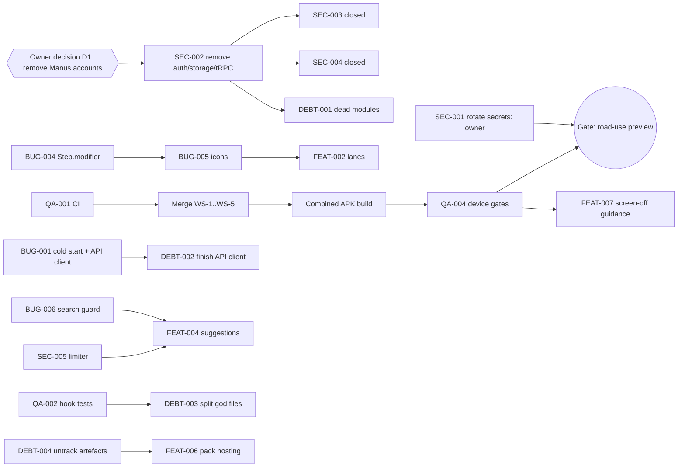

# NEXORA Maps — Master Roadmap

Audit date: 27 November 2026 · Commit audited: `main` @ `7d4215a` · Mode: read-only audit (only `docs/roadmap/` was written)

Companion documents:
- [TECHNICAL_AUDIT.md](TECHNICAL_AUDIT.md): evidence, validation ledger, full bug/risk register
- [FEATURE_BACKLOG.md](FEATURE_BACKLOG.md): feature specifications, deferred and rejected ideas
- [IMPLEMENTATION_PLAN.md](IMPLEMENTATION_PLAN.md): task packets, parallel workstreams, first sprint, prompt template
- [PRIORITISED_BACKLOG.csv](PRIORITISED_BACKLOG.csv): one row per actionable item (70 rows)

---

## 1. Executive summary

NEXORA Maps is a private, London-only journey-planning app for Android (Expo 57 / React Native 0.86), with a small Express API on Render's free plan. A user can search (LocationIQ), plan driving, walking and cycling routes with up to three stops (public OSRM), compare routes, see TfL road disruptions, download an offline London map, run a labelled simulation, or start **live GPS turn-by-turn guidance with voice**. Android Auto, CarPlay and lock-screen guidance code exists. The live guidance and car-display paths have **not been tested on a real device**, and the app says so in its UI.

The engineering base is better than typical for a preview. The pure domain logic in `shared/nexora/*` is well separated and well tested: 364 tests pass, the typecheck is clean, and lint has one warning. The server and Android bundle both build. Most risk sits in four places:

1. **Leftover Manus template server code.** OAuth, JWT sessions, a file-storage proxy and tRPC are still live on the public API although the app never uses them. This is where all the owner-known security items live: the leaked JWT secret, logout not revoking tokens, and stored files not tied to an owner. Removing that stack closes all three at once, and is cheaper than fixing each one (SEC-002).
2. **The free-tier cold start.** The map page and its scripts come from the Render API, and the app gives up after 10 seconds. After the server has slept, the first launch probably shows "Map unavailable", and search can stay labelled "setup required" for the whole session (BUG-001).
3. **Guidance correctness defects that the unit tests do not cover:**
   - a second reroute on a multi-stop trip sends you back to stops you have already visited (BUG-002);
   - round trips "arrive" on the first GPS fix (BUG-003);
   - U-turns are silent (BUG-004);
   - every non-left manoeuvre shows a right-turn arrow (BUG-005).
4. **No CI.** Render deploys `main` without running the tests (QA-001). Parallel workstreams make this the first thing to fix.

The recommended first sprint is in five independent workstreams that touch separate files, so they can run as parallel threads and then merge into one combined APK (see section 8).

## 2. What exists today

| Area | Status | Evidence |
|---|---|---|
| Interactive map (Leaflet in WebView, OSM raster online, PMTiles offline) | IMPLEMENTED | `components/nexora/JourneyMap.tsx`, `server/nexora/map-document.ts` |
| Live address search (LocationIQ, London viewbox) | IMPLEMENTED, submit-only | `server/nexora/geocoder.ts`, `hooks/use-nexora.ts:378-394` |
| Routing: car, foot and bike (public OSRM), alternatives, scoring | IMPLEMENTED | `server/nexora/routes.ts`, `shared/nexora/domain.ts` |
| Multi-stop (3) and leave-at / arrive-by | IMPLEMENTED; reroute defect BUG-002 | `shared/nexora/itinerary.ts` |
| Simulation with fault injection | IMPLEMENTED | `hooks/use-nexora.ts`, `NexoraApp.tsx:485-525` |
| Live GPS guidance, off-route reroute, voice (en-GB) | PARTIAL: code and unit tests, no device validation | `hooks/use-live-guidance.ts`, `shared/nexora/guidance.ts` |
| TfL road disruptions | PARTIAL: disruptions only, no speeds or ETA effect | `server/nexora/traffic.ts`, `shared/nexora/traffic.ts` |
| Offline London map and offline search | IMPLEMENTED (size and magic checks only, no sha256 on device) | `lib/offline-pack.ts`, `server/nexora/offline.ts` |
| Offline routing | ABSENT | capabilities `offlineRouting:false` |
| Android Auto, CarPlay, lock-screen guidance | PARTIAL / UNKNOWN: not run on DHU or device; CarPlay needs an Apple entitlement | `lib/car/*`, `plugins/with-car-displays.js` |
| Saved places, home/work, opt-in trip history, export and delete | IMPLEMENTED (local AsyncStorage) | `hooks/use-nexora.ts:57-166`, `:266` |
| Accounts and login | Present in code; **unused by the app** | `server/_core/oauth.ts`, `app/oauth/callback.tsx` |
| Community reports | Demo and local only | `components/nexora/Panels.tsx:1300-1510` |
| CI, crash reporting | ABSENT | no `.github/`, no error boundary |

Maturity: **private technical preview**. The core flows work on the emulator. Recorded evidence: `docs/screenshots/apk-render-2026-11-27/`, `docs/screenshots/settings-location-2026-11-27/android/`. Road-use guidance, car displays and multi-user operation are unvalidated. Section 3 of [TECHNICAL_AUDIT.md](TECHNICAL_AUDIT.md) gives the architecture and data-flow diagram.

**Unknowns:** Render dashboard settings, real cold-start duration, the LocationIQ plan quota, the EAS remote versionCode, the content of the unpushed `wip/local-snap` branch on Andrew's PC, and any behaviour on a physical phone.

## 3. Top risks

| # | Risk | Item | Why it matters |
|---|---|---|---|
| 1 | Leaked JWT secret and DB URL still valid | SEC-001 | Anyone with the old EAS logs can mint an admin token for a year. Owner action, plus code removal in SEC-002 |
| 2 | Unused auth/storage stack exposed on the internet | SEC-002/003/004 | It is the attack surface behind every owner-known security item |
| 3 | First launch after idle shows a broken map | BUG-001 | Free-tier cold start against 10 s and 18 s client timeouts |
| 4 | Guidance gives wrong directions in specific cases | BUG-002..005 | Safety-relevant once anyone drives with it |
| 5 | Untested merges deploy straight to production | QA-001 | Parallel threads raise the merge-break risk |
| 6 | Whole-API lockout or LocationIQ quota drain | SEC-005, SEC-007 | One shared rate-limit bucket behind Render's proxy; 50 MB bodies |
| 7 | Road use before device validation | QA-004 | LG-2, LG-6, LG-8, LG-9 and LG-10 have never run |

## 4. Prioritisation approach

- **P0:** urgent verified security issue or core-function blocker. **P1:** high-value reliability or workflow fix. **P2:** worthwhile once P0/P1 land. **P3:** defer pending evidence.
- **Score** = (Impact + Urgency + RiskReduction + StrategicFit) × confidence (0.5 / 0.75 / 1.0) ÷ effort weight (XS 1, S 2, M 3, L 5, XL 8). The CSV shows every component. The score only sorts within a priority. P0 status and hard prerequisites override it.
- Effort ranges assume one developer who knows the stack, and include tests. XS ≤ 0.5 day, S 0.5–2 days, M 3–5 days, L 1–2 weeks.
- No user research was available. Impact and strategic fit are the auditor's judgement against the app's stated purpose (a guest-first London planning and guidance preview).

**Totals (70 rows):**
- By priority: P0 6, P1 21, P2 28, P3 15.
- By kind: 62 findings and 8 proposed features.
- By evidence class (findings only): 58 VERIFIED (55 static code paths, 2 confirmed with screenshots, 1 lint run), 1 SUSPECTED, 2 RISK, 1 IMPROVEMENT.
- 3 verified findings have a suspected consequence that still needs runtime confirmation: BUG-008, BUG-001's cold-start duration, and SEC-005's Render proxy hop.

## 5. Phased roadmap

| Phase | Objective | Items | Exit criteria (gate) | Horizon |
|---|---|---|---|---|
| **0: Blockers** | Close leaked-secret exposure, make first launch reliable, get device evidence | SEC-001, SEC-002 (+003, 004), BUG-001, QA-004 | Old secret rejected. Manus routes return 404. Cold launch against a sleeping API loads the map. LG-1..LG-8 run on the emulator with build id recorded | Sprint 1 (QA-004 right after the combined APK) |
| **1: Correctness and safety net** | Fix the guidance defects, harden the public API, add CI and regression tests | BUG-002..009, SEC-005..007, QA-001..003, OPS-002, OPS-003, PRIV-001, UX-003, A11Y-001, A11Y-003, FEAT-001, cheap P2/P3 items in owned files (OPS-001, OPS-004, GEO-004, GEO-005, DOC-001, DEBT-008, UX-001, PERF-002, DEBT-004 dist-web part) | CI green and required. Every P1 has a regression test. Combined APK passes emulator smoke and LG rows | Sprint 1–2 (about 2–3 weeks) |
| **2: Foundations** | Make the code cheaper to change | DEBT-001..003, DEBT-004 (pack part, via FEAT-006), DEBT-007, PERF-001, PERF-003, GEO-001, GEO-002, SEC-008, SEC-009, QA-005, DOC-002 | No file over about 500 lines in `components/nexora`. Single API client. Bridge payload under 1 KB per tick. Repo without build output | 1–2 months |
| **3: UX and accessibility** | Clear, honest, accessible product | UX-002, UX-004..008, A11Y-002, A11Y-004, A11Y-005, FEAT-005, DEBT-006, PRIV-002 | TalkBack can complete a journey without the map. Accessibility Scanner clean on core screens. WCAG 2.2 AA contrast (proposed target) | 1–3 months, overlaps Phase 2 |
| **4: Capabilities** | Features that add user value on the stable base | FEAT-002, FEAT-003, FEAT-004, FEAT-006, GEO-003, GEO-006, DEBT-005 | Each feature meets its acceptance criteria and success metric ([FEATURE_BACKLOG.md](FEATURE_BACKLOG.md)) | Later (3+ months) |
| **5: Scale and experiments** | Things that need infrastructure or device certainty | FEAT-007, FEAT-008, I18N-001, CarPlay entitlement | Physical-device drives pass. A hosting decision is made | Later, evidence-dependent |

Rollback for every phase: each workstream merges as its own PR, so `git revert <merge>` on `main` and Render "Rollback to previous deploy" undo the server side. The previous APK (build id recorded per OPS-003) stays installable.

## 6. Dependencies and critical path

The critical path to a trustworthy preview build runs: QA-001 → (WS-1 … WS-5 in parallel) → merge → combined APK → QA-004 device gates.

Foundational unlocks:
- SEC-002 closes 3 security items and makes DEBT-001 and client-side Manus cleanup trivial.
- QA-002 hook tests unlock the DEBT-003 refactor safely.

## 7. Milestones and release gates

| Milestone | Contents | Gate (testable) |
|---|---|---|
| M0: Secrets rotated | SEC-001 (owner) | A token signed with the old secret gets 401 on Render. The new JWT_SECRET is at least 32 bytes, or unused after SEC-002 |
| M1: CI live | QA-001 | A PR with a failing test is blocked |
| M2: Combined preview APK | WS-1..WS-5 merged | `pnpm check`, `pnpm lint` (0 warnings) and `pnpm test` are green. Emulator smoke: cold launch against a sleeping API, search, route, simulate, live start acknowledgement, back button |
| M3: Device-validated guidance | QA-004 | LG-1..LG-10 recorded with build id and commit. DHU checklist run |
| M4: Maintainable base | Phase 2 | File-size and bridge-payload targets met. No dead Manus code |
| M5: Accessible beta candidate | Phase 3 | TalkBack journey without the map. Scanner clean |

## 8. First sprint: five parallel workstreams for one combined APK

One developer would do these in sequence over about two weeks. As parallel threads they touch **disjoint files**, so they can merge without conflicts. Full packets are in [IMPLEMENTATION_PLAN.md](IMPLEMENTATION_PLAN.md#2-parallel-workstreams-for-the-combined-apk).

| WS | Theme | Owns (only these files) | Items |
|---|---|---|---|
| **WS-1** | Server hardening and Manus removal | `server/**` except `server/nexora/route-mapper.ts`; `render.yaml`; `drizzle/`, `drizzle.config.ts`; server tests | SEC-002 (+003, 004), SEC-001 code part, SEC-005, SEC-006, SEC-007, QA-003, OPS-001, OPS-002 (server), GEO-004, DEBT-001 (server files), UX-001 |
| **WS-2** | Guidance correctness | `shared/nexora/{guidance,car-guidance,domain,provider}.ts`, new `shared/nexora/maneuver.ts`, `server/nexora/route-mapper.ts`, their tests, and **only** the turn-icon lines `components/nexora/NexoraApp.tsx:275-282` | BUG-003, BUG-004, BUG-005, GEO-005; stretch GEO-001 |
| **WS-3** | Client networking and resilience | `hooks/use-nexora.ts`, `hooks/use-live-guidance.ts`, `components/nexora/JourneyMap.tsx`, `lib/offline-pack.ts`, new `lib/nexora-api.ts`, new `shared/nexora/reroute.ts`, their tests | BUG-001, BUG-002, BUG-006 (hook), BUG-007, PERF-002, GEO-002 (atomic swap), DEBT-002 (wrapper), SEC-009 |
| **WS-4** | UI, UX and accessibility | `components/nexora/NexoraApp.tsx` (except WS-2's lines), `components/nexora/Panels.tsx`, `components/nexora/ui.tsx`, `app/_layout.tsx`, `app/dev/*` | BUG-008, BUG-009, UX-003, A11Y-001, A11Y-003, FEAT-001, OPS-002 (ErrorBoundary), DEBT-008, BUG-006 (Panels part); stretch UX-002, UX-004/FEAT-005, A11Y-002, A11Y-005 |
| **WS-5** | Build, CI, config and docs | `.github/**`, `app.config.ts`, `eas.json`, `package.json`, `pnpm-lock.yaml`, `.gitignore`, `.nvmrc`, `dist-web/`, `README.md`, `docs/HANDOVER.md`, `docs/SETUP.md`, new `docs/RELEASE.md` | QA-001, PRIV-001, OPS-003, OPS-004, DEBT-004 (dist-web only), DOC-001, DOC-002 |

Rules for all workstreams:
- Do not add dependencies outside WS-5.
- Each workstream adds the tests for the code it changes (QA-002 is split this way).
- Merge order: WS-5 → WS-1 → WS-2 → WS-3 → WS-4. WS-4 goes last because it shares `NexoraApp.tsx` with WS-2's small hunk.

**Start first:** WS-5's CI job (QA-001). It is a half-day task, and from then on every other workstream's PR is checked automatically. If you want to run only one task, do SEC-001 first. It needs no code: rotate the secrets in Render and EAS.

**Fallback if capacity is lower:** ship WS-5 (CI), WS-1 (SEC-002, SEC-005), WS-3 (BUG-001) and WS-2 (BUG-005). Move WS-4 to sprint 2.

## 9. Decisions needed from the owner

| ID | Decision | Recommendation |
|---|---|---|
| D1 | Remove the Manus login/storage/tRPC stack now (guest-only app) or keep it and fix SEC-003, SEC-004 and SEC-005 individually? | **Remove.** No screen uses it. Accounts can be rebuilt later on a reviewed design |
| D2 | Final Android applicationId and URL scheme (currently `space.manus.nexora.t…`) | Decide before any wider distribution. Changing it later means a fresh install for every tester. Not needed for sprint 1 |
| D3 | Rotate and then delete the old EAS environment variables and build logs that exposed DATABASE_URL and JWT_SECRET | Do it now (dashboard work; not checkable from here) |
| D4 | Cold-start handling | Mitigate in the app (BUG-001). An external uptime pinger is optional. Check that it stays within Render free-plan hours and terms |

## 10. Recommended next action

1. Andrew rotates the secrets (SEC-001 / D3) and answers D1.
2. The coordinator starts the five workstream threads using the prompt template in [IMPLEMENTATION_PLAN.md](IMPLEMENTATION_PLAN.md#7-reusable-single-task-prompt-template), WS-5 first.
3. After all five merge, run one EAS `production-apk` build. It needs Andrew's typed approval. Then run the QA-004 device rows against that build.
