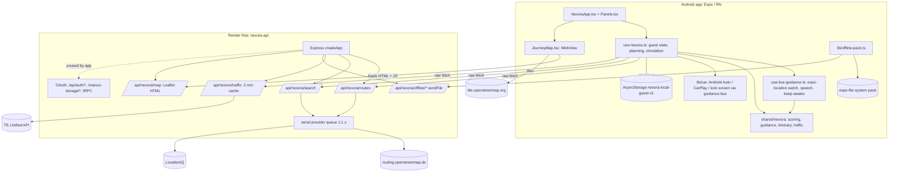

# NEXORA Maps — Technical Audit

Audit date: 27 November 2026 · Commit: `main` @ `7d4215a` (shallow clone, 8 commits visible) · Back to [MASTER_ROADMAP.md](MASTER_ROADMAP.md)

## 1. Scope and method

- **Source of truth:** the GitHub repo `Amepps1994/nexora-maps`, branch `main`, cloned fresh into a cloud container.
  - The PC working copy `C:\Users\andre\Documents\NEXORA-Maps` and its unpushed branch `wip/local-snap` were **not inspected**. Any edits there are outside this audit.
- **Read-only.** No application source, configuration or dependency manifest was changed. The only writes are the five files in `docs/roadmap/`.
  - Dependencies were installed into the container's `node_modules/`, which is gitignored, so validation could run there.
  - Build output went to a scratch folder outside the repo.
  - `git status` was clean before and after the checks.
- **Repository instructions:** there is no `CLAUDE.md`, `AGENTS.md` or `CONTRIBUTING.md`. Existing project rules come from `docs/HANDOVER.md` and `docs/ROADMAP.md`: no fabricated data, demo content labelled, manifest states change only with evidence.
- **Reviews:** five independent read-only reviews ran in parallel: architecture/performance, geospatial, security/privacy, UX/accessibility, and QA/ops. They wrote evidence notes with file:line references.
  - The auditor consolidated them, removed duplicates, and spot-checked the key claims against the code (section 6).
  - One reviewer claim was found to be **wrong** and was dropped (section 6).
- **Not done:**
  - No live provider calls: OSRM, LocationIQ and TfL are blocked from the container, and live calls would spend quota.
  - No device or emulator runs, and no EAS build (paid, needs approval).
  - Render was unreachable from the container.
- **Evidence classes:**
  - VERIFIED-static: the execution path was traced in code.
  - VERIFIED-screenshot: seen in a committed screenshot.
  - VERIFIED-runtime: reproduced by a command.
  - SUSPECTED, RISK, IMPROVEMENT and PROPOSED: as defined in the brief.

## 2. Repository inventory

| Path | What it is | Size |
|---|---|---|
| `app/` | Expo Router: one real screen, `(tabs)/index.tsx` → `NexoraApp`; plus `oauth/callback.tsx` and `dev/theme-lab.tsx` | small |
| `components/nexora/` | `NexoraApp.tsx` (1459 lines), `Panels.tsx` (1736), `JourneyMap.tsx` (231), `ui.tsx` (205) | god files |
| `hooks/` | `use-nexora.ts` (967 lines, 42 `useState`), `use-live-guidance.ts` (316), `use-traffic.ts`, `use-offline-regions.ts`, `use-auth.ts` (Manus) | |
| `shared/nexora/` | Pure domain: domain, session, guidance, itinerary, traffic, offline, status, provider, car-guidance, fixtures | well tested |
| `lib/` | `offline-pack.ts`, `car/*` (Android Auto/CarPlay/lock screen), `_core/*` (Manus auth, API helpers), `trpc.ts` | |
| `server/_core/` | Manus starter: Express app, CORS, OAuth, JWT SDK, storage proxy, tRPC, plus unreachable LLM, image, voice, data and heartbeat modules | |
| `server/nexora/` | `routes.ts` (capabilities, map, routes, search), `geocoder.ts`, `traffic.ts`, `offline.ts`, `route-mapper.ts`, `bike-snap.ts`, `map-document.ts`, `map-assets/` (Leaflet 1.9.4, pmtiles, protomaps-leaflet), `offline-data/london/` (56 MB PMTiles, 5.5 MB search.json) | |
| `tests/` | 14 vitest files | 366 cases |
| `docs/` | ROADMAP (105 KB, 141-entry FEATURE_MANIFEST), HANDOVER, SETUP, DEVICE_TEST_PLAN, CAR_DISPLAYS, OFFLINE_MAPS, PRIVACY_SECURITY, and 17 dated output logs | |
| `dist-web/` | Committed web export (stale) | 3.7 MB |
| Config | `app.config.ts`, `eas.json` (one profile, `production-apk`), `render.yaml` (free, Frankfurt), `.npmrc` (`node-linker=hoisted`), `packageManager: pnpm@9.12.0` | |

**Stack:** Expo ~57.0.24, React Native 0.86.3, React 19.2.3, TypeScript ~6.0.3 (strict), expo-router, NativeWind, react-native-webview, expo-location, expo-speech, expo-keep-awake, expo-file-system, @iternio/react-native-auto-play 0.10.5, Express 4, zod 4, vitest 2.1.9.

**Feature manifest state** (`docs/FEATURE_MANIFEST.json`, 141 entries):
- 9 implemented/tested
- 8 implemented but unverified
- 3 demo only
- 52 planned
- 69 requires provider/approval

This audit does not change manifest states.

**Git health:**
- History is short (all visible commits are from 26–27 Nov 2026), with one merged PR (#1).
- No CI.
- The 56 MB PMTiles file was force-added despite a `.gitignore` rule (`render.yaml:2-3` says so).
- The `.git` pack is about 85 MB.

## 3. Current architecture

Data flow:
1. On launch, `use-nexora` reads guest state from AsyncStorage and fetches `/api/nexora/capabilities` **once** (`hooks/use-nexora.ts:152-156`).
2. The map WebView loads `/api/nexora/map` from the API (`JourneyMap.tsx:55`).
3. Search and route requests are raw `fetch` calls to the API. The API serialises every upstream call through one queue (`server/nexora/routes.ts:52-88`).
4. The selected route drives either the simulation timer or the live GPS watch. Guidance state is published to car displays through `lib/car/guidance-bus.ts`.
5. On every change the whole `MapData` object is re-sent to the WebView (`NexoraApp.tsx:49-79`, `JourneyMap.tsx:140-143`).

tRPC and react-query are mounted in `app/_layout.tsx:55-94`, but no procedure is ever called.

## 4. Baseline validation ledger

| # | Check | Command | Ran | Outcome | Evidence |
|---|---|---|---|---|---|
| 1 | Working tree | `git status --short` | yes | PASS (clean before/after) | no output |
| 2 | Install from lockfile | `pnpm install --frozen-lockfile --ignore-scripts` | yes | PASS | 1235 packages, 5.8 s, container only |
| 3 | Typecheck | `pnpm check` (`tsc --noEmit`) | yes | PASS | 0 errors, 7.4 s |
| 4 | Unit/integration tests | `pnpm test` (vitest) | yes | PASS | 14 files (13 passed, 1 skipped); **364 passed, 1 skipped, 1 todo**; 8.35 s. The stderr line `[OAuth] ERROR: OAUTH_SERVER_URL is not configured` is expected noise |
| 5 | Lint | `pnpm lint` (expo lint) | yes | PASS with 1 warning | `NexoraApp.tsx:72` unnecessary useMemo dep `navHeight` (DEBT-008); also a MODULE_TYPELESS warning for `eslint.config.js` |
| 6 | Server bundle | `pnpm build --outdir=<scratch>` | yes | PASS | `index.js` 67.9 kb |
| 7 | Android JS bundle | `npx expo export --platform android --output-dir <scratch>` | yes | PASS | one 6 MB Hermes bundle, 38 s |
| 8 | Render health | `curl https://nexora-api-cfoh.onrender.com/api/nexora/capabilities` | yes | BLOCKED | HTTP 000: the container's egress proxy has no route. Not a product defect |
| 9 | iOS export | — | no | SKIPPED | iOS is not a current target; CarPlay is gated on an Apple entitlement |
| 10 | EAS APK build | — | no | SKIPPED | Paid build; needs Andrew's typed approval |
| 11 | Emulator/device runs (LG-1..10, DHU) | — | no | BLOCKED | No device in the container. See QA-004 |
| 12 | Live provider calls | — | no | SKIPPED | Would consume quota; egress is blocked |
| 13 | Secret pattern scan of tracked files | `grep` for DB URLs, `pk.`, `sk-`, `AIza`, `JWT_SECRET=` values | yes | PASS | No secret values in tracked files, including `dist-web/` and `docs/` |

No performance baselines (bundle analysis, latency, memory) were measured. The targets in this roadmap are therefore **proposed**.

## 5. Bug, risk and improvement register

Columns, scores and acceptance criteria for every row are in [PRIORITISED_BACKLOG.csv](PRIORITISED_BACKLOG.csv). Each P0/P1 item is expanded below. P2/P3 items are listed in 5.3 with their key evidence.

### 5.1 P0

#### SEC-001: Leaked JWT_SECRET / DATABASE_URL are still dangerous
- **Category:** Security. **Evidence:** VERIFIED-static for the code facts. The leak itself is the owner's report and was not seen here. **Confidence:** high. **Severity:** Critical until rotated. **Priority:** P0.
- **Evidence:**
  - Tokens are HS256 with `exp` only, valid for one year (`server/_core/sdk.ts:174-177`, `server/_core/oauth.ts:81-84`).
  - `MANUS_JWT_SECRET` takes precedence over `JWT_SECRET` (`server/_core/env.ts:3`), so rotating only `JWT_SECRET` may change nothing.
  - The app-id check is skipped when the app id is empty (`server/_core/sdk.ts:200`).
  - The owner's `openId` ships in the client bundle as `EXPO_PUBLIC_OWNER_OPEN_ID`, and that openId is upserted as `admin` (`server/db.ts:55-61`).
  - The 32-byte minimum already fails closed (`sdk.ts:133-139`).
- **Impact:** anyone holding the old secret can sign an admin token for a year. The DB URL gives direct table access.
- **Fix:**
  1. Rotate `JWT_SECRET`, and confirm `MANUS_JWT_SECRET` is unset or rotated.
  2. Rotate the DB credentials.
  3. Delete the old EAS environment variables and, if possible, the old build logs.
  4. In code, fail at startup in production when the app id is empty.
  5. If D1 (remove the Manus stack) is accepted, the JWT path disappears entirely (SEC-002).
- **Effort:** XS (dashboard work) plus XS (code). **Rollback:** none needed.
- **Acceptance:** an old-secret token gets 401; production start fails when the app id is empty.

#### SEC-002: Unused Manus auth/storage/tRPC stack is live on the public API
- **Evidence:** VERIFIED-static. **Confidence:** high. **Severity:** High. **Priority:** P0, pending owner decision D1.
- **Evidence:** these routes are registered:
  - `server/_core/app.ts:24-28` registers the storage proxy and OAuth routes.
  - `server/_core/oauth.ts:68-189` defines `/api/oauth/callback`, `/api/oauth/mobile`, `/api/auth/logout`, `/api/auth/me` and `/api/auth/session`.
  - tRPC exposes `system.health`, `system.notifyOwner` (admin) and `auth.me/logout` (`server/routers.ts`).
  - Every tRPC call runs `sdk.authenticateRequest`. On an unknown user that means a DB lookup and an outbound call to the OAuth server (`server/_core/context.ts:15`, `sdk.ts:263-279`).
  - The app has no login entry point. `useAuth` is used only by `app/oauth/callback.tsx`.
- **What it would close:**
  - SEC-003: the storage proxy serves any key to any session (`server/_core/storageProxy.ts:6-21`).
  - SEC-004: logout only clears the cookie, and `/api/auth/session` re-issues a one-year cookie from any bearer token (`oauth.ts:140-188`; open `it.todo` at `tests/security-admin-account.test.ts:379`).
  - Weak OAuth `state`: a base64 of the redirect URI with no nonce (`constants/oauth.ts:88-94`). The deep link also accepts a raw `sessionToken` (`app/oauth/callback.tsx:26-29`), which allows session fixation.
  - The `cron_` openId path, which sends the bearer token to an external server (`sdk.ts:256-262`).
- **Fix:**
  1. Stop registering these routes in `createApp`.
  2. Delete the server modules.
  3. Turn the existing security tests into 404 assertions.
  4. Leave client-side Manus files for Phase 2. With no server routes they are dead code.
- **Effort:** M. **Acceptance:** the listed routes return 404, and check, lint and test pass.
- **Rollback:** revert the PR. No data migration is involved; no tables are read by the app.

#### SEC-003 / SEC-004
Both are recorded separately so the owner-known items stay traceable. Each is closed by SEC-002. If D1 decides to keep accounts:
- SEC-003 needs `u/<userId>/` key prefixes and traversal rejection.
- SEC-004 needs a `tokenVersion` column checked in `authenticateRequest`.

Details are in the CSV.

#### BUG-001: First launch after Render sleeps shows a broken map and a mislabelled search
- **Evidence:** VERIFIED-static for the code path. The cold-start duration is inferred: the Render free tier spins down after 15 minutes idle. **Confidence:** high. **Severity:** High. **Priority:** P0 (core function).
- **Evidence:**
  - The map document and its roughly 310 KB of scripts come from the API (`JourneyMap.tsx:55`).
  - The map fails after 10 s (`JourneyMap.tsx:69-71`). The route request aborts after 18 s (`use-nexora.ts:413-414`) and shows the raw `e.message` (`:455`).
  - Capabilities are fetched once with `.catch(() => {})` (`use-nexora.ts:152-156`). On failure, search shows "Live address search: setup required" for the whole session (`Panels.tsx:346-348`, `:430`).
  - Between 0 and 10 s there is no spinner on the map.
  - The committed web screenshot `docs/screenshots/live-guidance-off-route.png` shows "Map unavailable" during guidance. It comes from an older build, so it is not counted as a reproduction.
- **Fix:**
  1. Send a warm-up `GET /api/health` at launch.
  2. Show a "Waking the NEXORA server (up to a minute)" state.
  3. Make the map timeout progressive (show a message at 8 s and fail only after about 60 s with a retry).
  4. Retry capabilities with backoff, and re-fetch them when the search panel opens.
  5. Map `AbortError` to friendly copy.
  6. Medium term: bundle the map HTML into the app (`source={{html}}`), as the offline shell already does, so the map does not depend on the API at all (see DEBT-002 / PERF-003).
- **Effort:** M.
- **Acceptance:** against an API delayed by 45 s, the wake-up message appears within 3 s, the map loads with no error card, and search shows the configured provider once the API answers.

#### QA-004: Real-device gates have not been run
- **Evidence:** VERIFIED-static from the docs. **Severity:** High. **Priority:** P0 before any road use.
- **Evidence:** `docs/DEVICE_TEST_PLAN.md:111-138`.
  - LG-1, LG-3, LG-4 and LG-7 have passed on the mock web drive only.
  - LG-5 has passed as a unit test only.
  - LG-2, LG-6, LG-8, LG-9 and LG-10 have not been run.
  - The Android Auto DHU checklist (`docs/CAR_DISPLAYS.md`) has never been run.
- **Fix:** after the combined APK, run LG-1 to LG-8 on the x86_64 emulator with `docs/mock-gps/*.gpx`, and LG-9 and LG-10 on a physical phone. Record the EAS build id and commit for each row.

### 5.2 P1

| ID | Finding | Key evidence | Fix (summary) | Effort |
|---|---|---|---|---|
| **BUG-002** | The second reroute on a multi-stop trip re-adds visited stops. `passed` counts waypoints on the *current* (already rerouted) route, but `slice` runs on the *original* `stops`, and `applyReroute` never trims them | `hooks/use-nexora.ts:185-205`, `shared/nexora/guidance.ts:437` | Pure `rerouteRequest(stops, visitedOffset, passedOnCurrent)` in `shared/nexora/reroute.ts`, plus a cumulative visited-offset ref, reset per trip | S |
| **BUG-003** | Round trip (origin = destination with stops) is marked "arrived" on the first fix. The proximity clause fires near the final vertex, and `checkItinerary` rejects only *adjacent* duplicates | `shared/nexora/guidance.ts:253-256`, `shared/nexora/itinerary.ts:29-36` | Require `alongM >= totalM - max(200, 2*radius)` for the proximity clause | XS |
| **BUG-004** | OSRM `continue` plus `uturn`, `left` or `right` maps to a silent "Continue". Also "Turn uturn", "take exit indicated", `ref` ignored | `server/nexora/route-mapper.ts:6-17`, `shared/nexora/guidance.ts:53` (`SILENT_TYPES`), `shared/nexora/car-guidance.ts:170` | Map modifiers properly; add `modifier` to `Step`; speak non-straight `continue` | S |
| **BUG-005** | The turn icon is a right arrow for anything whose text does not contain "left" (also English-only) | `components/nexora/NexoraApp.tsx:275-282`; screenshot `settings-location-2026-11-27/android/16-sim-running.png` ("Continue onto Borough High Street" with a right arrow) | Pure `maneuverIcon(step)` from type and modifier | S |
| **BUG-006** | Live search has no timeout, abort or generation guard; typing clears real results | `hooks/use-nexora.ts:378-394`, `components/nexora/Panels.tsx:363-366` | Same AbortController and generation pattern as `calculate()` (`:412-414`); keep results while refining | XS |
| **BUG-007** | The reroute fetch has no timeout. A candidate that returns while the user is stationary is discarded, and the next try waits 15 s | `hooks/use-nexora.ts:185-201`, `hooks/use-live-guidance.ts:156`, `shared/nexora/domain.ts:402` | 10 s abort; evaluate the off-route criteria at request time or keep the candidate | S |
| **BUG-008** | No `BackHandler` anywhere; all sheets are state on one route, so back probably exits the app (behaviour SUSPECTED, not run) | grep of `app/`, `components/`, `hooks/`; `NexoraApp.tsx:595` | Back closes the panel first; during guidance it asks to confirm | S |
| **BUG-009** | `prefs.onboardingSeen` is written but never read, so onboarding never shows. The origin silently defaults to King's Cross | `Panels.tsx:1543`, `use-nexora.ts:55,74,91`; screenshot `apk-render-2026-11-27/route-options.png` | Show onboarding when `hydrated && !onboardingSeen`; add a location primer; make the demo origin prominent | S |
| **SEC-005** | No `trust proxy`, so `req.ip` is Render's proxy and every client shares one 15/min bucket covering both search and routes. The `limits` map is never pruned. CORS is skipped when there is no `Origin` header | `server/nexora/routes.ts:89-99,150,278`, `server/_core/cors.ts:89-92` | `trust proxy` 1; separate limits; daily search cap; prune | S |
| **SEC-006** | The map page's `message` listener has no origin check, and `bindTooltip(p.name)` sets innerHTML (Leaflet 1.9.4). Served on the API origin with no framing protection. Today `places` are only `DEMO_PLACES`, and native WebView users cannot be reached this way, so practical impact is limited to the web origin | `server/nexora/map-document.ts:17,23,43` | Check `e.origin` and `e.source`; use a `textContent` tooltip node; explicit `targetOrigin` | S |
| **SEC-007** | `express.json({limit:"50mb"})` on every route; unbounded shared queue (15 s per job; cycling re-snap uses up to 4 upstream calls) | `server/_core/app.ts:24-25`, `server/nexora/routes.ts:52-88,172-200` | 16 KB limit; queue cap with 503; one queue per upstream; drop on client disconnect | S |
| **PRIV-001** | `expo-audio` (microphone permission) and `expo-video` (background playback) plugins are declared but never imported | `app.config.ts:133-145` | Remove the plugins and the dependencies; confirm the merged manifest | XS |
| **QA-001** | No CI; Render builds `main` with install and build only | `render.yaml:15`; no `.github/` | GitHub Actions: check, lint, test, build; required on `main` | S |
| **QA-002** | No test imports `use-live-guidance`, `use-nexora`, `use-offline-regions`, `lib/offline-pack` or `lib/car/car-displays` | `tests/*.ts` import lines | Extract pure controllers; add the tests in section 7 | M |
| **QA-003** | No HTTP tests for search, throttle, queue or capabilities | `server/nexora/routes.ts:60-137,264` | Supertest with fetch mocked, as in `tests/nexora-itinerary.test.ts:296-312` | S |
| **OPS-002** | No error boundary or crash reporting. The server entry logs a fixed string on start failure and does not exit non-zero | `app/_layout.tsx`, `server/_core/index.ts:15-17` | Root ErrorBoundary; log the error and `process.exit(1)`; optional opt-in crash reporting | S |
| **OPS-003** | `eas.json` has only `production-apk`: no `autoIncrement`, no preview profile, no rollback doc. `apiBaseUrl` silently falls back to the prod Render URL | `eas.json`, `app.config.ts:62,77` | `autoIncrement`; preview profile; `docs/RELEASE.md` | S |
| **UX-003** | Up to six disclaimers stacked on the routes sheet. "Start live GPS guidance" is the primary CTA while its own note says it is untested; no one-time acknowledgement | `Panels.tsx:762-766,1000-1025`, `NexoraApp.tsx:270,739` | One concise safety line; acknowledgement modal before the first live start | S |
| **A11Y-001** | The turn and event banners are not live regions, so muted-voice TalkBack users get nothing | `NexoraApp.tsx:255-326` | `accessibilityLiveRegion` polite for steps, assertive for off-route | XS |
| **A11Y-003** | Contrast: dark-mode safety label `#9B6500` on `#152235` = 3.24:1; radio ring 2.01:1; switch track 1.5:1 | `NexoraApp.tsx:1383`, `Panels.tsx:170,993,1678` | Darker or brighter tokens per theme | S |
| **FEAT-001** | No text step list, so there is no screen-reader alternative to the map (see [FEATURE_BACKLOG.md](FEATURE_BACKLOG.md#feat-001-text-step-list-and-route-overview)) | `NexoraApp.tsx:287-294` | Steps list in the routes sheet and the guidance panel | S |

### 5.3 P2 and P3 (summary)

| ID | Pri | Finding | Evidence |
|---|---|---|---|
| GEO-001 | P2 | SUSPECTED: unbounded forward snap on self-overlapping geometry | `shared/nexora/guidance.ts:126-140,250` |
| GEO-002 | P2 | Offline pack sha256 not verified on device; update deletes the old pack before downloading | `lib/offline-pack.ts:95-121` |
| GEO-003 | P2 | OSMF tile server used directly. Fine for a private preview; review its usage policy before wider beta | `server/nexora/map-document.ts:7-11` |
| GEO-004 | P2 | Server `.max(5)` stops vs client and capabilities 3 | `server/nexora/routes.ts:26,110`, `shared/nexora/itinerary.ts:8` |
| GEO-005 | P2 | `z.coerce.number()` turns an empty lat/lon into 0 | `shared/nexora/provider.ts:45-46` |
| GEO-006 | P3 | TfL matching is vertex-based within 60 m and ignores direction | `shared/nexora/traffic.ts:301-316` |
| PERF-001 | P2 | Full `MapData` re-sent every tick; places rebuilt every update | `NexoraApp.tsx:49-79`, `JourneyMap.tsx:140-143`, `map-document.ts:23-29` |
| PERF-002 | P2 | `exportData` stringified on every render | `hooks/use-nexora.ts:845-846` |
| PERF-003 | P2 | Pack bytes go through the free instance; synchronous manifest reads | `server/nexora/offline.ts:17-42,69` |
| SEC-008 | P2 | No CSP, frame-ancestors, nosniff or Referrer-Policy; X-Powered-By is on | `server/_core/app.ts:18-46` |
| SEC-009 | P3 | WebView whitelist `https://*`; prefix navigation guard | `JourneyMap.tsx:175-180` |
| PRIV-002 | P3 | Home, work and saved places in plaintext AsyncStorage. Trip history is correctly opt-in (`use-nexora.ts:266`, verified) | `hooks/use-nexora.ts:57-66` |
| DEBT-001 | P2 | Unreachable modules: `llm.ts`, `imageGeneration.ts`, `voiceTranscription.ts`, `dataApi.ts`, `heartbeat.ts`, `server/storage.ts`, template UI | grep of imports |
| DEBT-002 | P2 | tRPC and react-query unused; three separate `/routes` call sites; responses not validated; `capabilities: any` | `app/_layout.tsx:55-94`, `use-nexora.ts:129,186,431,647` |
| DEBT-003 | P2 | God hook and god components; no `React.memo` | file sizes above |
| DEBT-004 | P2 | `dist-web/` tracked and stale; 56 MB pack force-added (new packs silently ignored) | `.gitignore`, `git ls-files` |
| DEBT-005 | P2 | Manus identity: bundle id, scheme, icon on `files.manuscdn.com`, package name `app-template` | `app.config.ts:9,26-27,36`, `package.json:2` |
| DEBT-006 | P3 | Theme tokens unused; about 80 hex literals; dark mode ignores system | `NexoraApp.tsx:43-45`, `theme.config.js` |
| DEBT-007 | P3 | `any` at trust boundaries | `JourneyMap.tsx:88`, `route-mapper.ts:6` |
| DEBT-008 | P3 | Lint warning | `NexoraApp.tsx:72` |
| QA-005 | P3 | Hand-mutated `process.env`; shared limiter state across tests | `tests/nexora-itinerary.test.ts:319-387` |
| OPS-001 | P2 | Health check on `/capabilities`, which says "simulation only" | `render.yaml:16`, `routes.ts:130-131` |
| OPS-004 | P3 | Node pinned only in `render.yaml` | `render.yaml:20` |
| DOC-001 | P2 | README, HANDOVER and SETUP describe Manus-era state ("no APK", "lookup not configured", "offline/car not implemented") | `README.md:7-40`, `docs/HANDOVER.md:3,45` |
| DOC-002 | P3 | Stale logs in `docs/` (139 and 181 tests vs 364 now) | `docs/test-output*.txt` |
| UX-001 | P2 | Attribution draws a 3-line band across the map | `map-document.ts:9,21`; screenshot `android/00-launch.png` |
| UX-002 | P2 | Contradictory copy ("multi-stop planned for beta", "simulated trip" history, raw enum "undetermined") | `NexoraApp.tsx:988-1011`, `Panels.tsx:1216` |
| UX-004 | P2 | Test tools in end-user UI; `/dev/theme-lab` ships | `NexoraApp.tsx:485-525`, `Panels.tsx:1404-1510` |
| UX-005 | P2 | Destructive actions not confirmed | `Panels.tsx:238-246,1243-1249` |
| UX-006 | P3 | Empty speed tile; unlabelled lock icon | `NexoraApp.tsx:345-408` |
| UX-007 | P3 | Static sheet with a decorative handle | `NexoraApp.tsx:588-631` |
| UX-008 | P3 | Reduced motion and keyboard do not follow the OS | `use-nexora.ts:71` |
| A11Y-002 | P2 | No selected state or roles on segmented controls | `Panels.tsx:716-786` |
| A11Y-004 | P2 | 14 text styles at 10 px or below (safety label 9 px); absolute offsets | `NexoraApp.tsx:1273-1421` |
| A11Y-005 | P3 | Targets under 48 dp | `NexoraApp.tsx:1274-1279` |
| I18N-001 | P3 | Inline strings; hard-coded en-GB | `NexoraApp.tsx:976`, `use-live-guidance.ts:55` |

## 6. Verification of reviewer claims

Spot-checked by the auditor against the code:

| Claim | Result |
|---|---|
| No `trust proxy` in `server/` | **Confirmed** (grep returns nothing) |
| `bindTooltip(p.name)` and an origin-less `message` listener | **Confirmed** (`map-document.ts:23,43`) |
| Reroute slices the original `stops` by `passed` | **Confirmed** (`use-nexora.ts:185-205`) |
| Turn icon checks for "left" in the instruction text | **Confirmed** (`NexoraApp.tsx:275-282`) |
| `Step` has no `modifier` field | **Confirmed** (`shared/nexora/domain.ts:13-19`) |
| Trip history is gated on `prefs.history` | **Confirmed** (`use-nexora.ts:266`). It was a suspicion in one review |
| No `BackHandler` | **Confirmed** (grep) |
| "expo-keep-awake installed but never used" (UX review) | **Rejected.** `hooks/use-live-guidance.ts:12,209,270` activates and deactivates keep-awake during live guidance. Simulation does not keep the screen awake, which is minor and not filed |

## 7. Test gaps and the ten highest-value tests to add

Coverage that exists:
- Pure domain: scoring, session, guidance projection and off-route, itinerary, traffic, offline manifest, car manoeuvre mapping.
- HTTP for `POST /api/nexora/routes`, the offline file routes, CORS, and the auth/admin surface.

Gaps: hooks, components, `/search`, `/capabilities`, the throttle and queue, map-document messaging, and on-device storage. No vitest config or coverage tooling.

Proposed test pyramid: about 70% unit (keep extracting pure controllers), about 25% integration (`createApp()` on port 0 with fetch mocked, plus `renderHook` with mocked expo modules), and about 5% E2E (promote the `scripts/*-smoke.js` browser drives to Playwright against the web export, plus one Maestro emulator flow run manually or nightly).

The ten tests to add before refactoring:
1. **Live-guidance controller:** a GPX replay of `docs/mock-gps/kings-cross-tate-modern-detour.gpx` yields exactly one reroute after three stable fixes.
2. **Reroute stop offset:** visited stops accumulate across two reroutes (BUG-002).
3. **Round-trip arrival:** a loop route does not arrive on the first fix (BUG-003).
4. **Manoeuvre table:** `continue`/`uturn`, `continue`/`left` and a roundabout without an exit each produce the right text, voice and icon (BUG-004, BUG-005).
5. **Stale search:** a slow older response never overwrites a newer one (BUG-006).
6. **`GET /api/nexora/search`:** 200, 404 (empty), 429, 5xx, malformed rows, attribution present, key never echoed.
7. **Throttle with trust proxy:** distinct `X-Forwarded-For` clients get independent buckets, and the 16th request gets 429 (SEC-005).
8. **Map document:** a foreign-origin message is ignored, and HTML in a name stays text (SEC-006).
9. **Offline pack:** an interrupted update keeps the old pack, and a corrupted file is rejected (GEO-002).
10. **Removed routes:** `/api/oauth/*`, `/api/auth/*`, `/manus-storage/*` and `/api/trpc/*` return 404 (SEC-002).

## 8. Areas not applicable or not inspected

- **Not applicable:**
  - Antimeridian and polar handling (London only; coordinate validation is in place).
  - CRS transforms (WGS84 throughout; Leaflet EPSG:3857 is handled internally).
  - Server database performance (the app does not use the DB).
- **Not inspected:**
  - The PC branch `wip/local-snap`.
  - Render and EAS dashboards.
  - Old EAS logs and git history before the shallow clone.
  - Generated native manifests (no prebuild was run).
  - `lib/car/car-displays.tsx` and `plugins/with-car-displays.js` line by line.
  - Offline search ranking quality.
  - Dependency CVE status (no reliable offline advisory source; run `pnpm audit` in CI).
  - Bundle composition.
- **Licensing items to verify, not conclusions:**
  - The OSMF tile usage policy for the preview vs a beta.
  - The LocationIQ free-plan attribution and autocomplete terms (the app does show "Search by LocationIQ.com", `Panels.tsx:440-452`).
  - TfL open-data attribution (shown when disruptions are drawn).
  - Whether the offline attribution names Protomaps/OpenMapTiles sources correctly.
