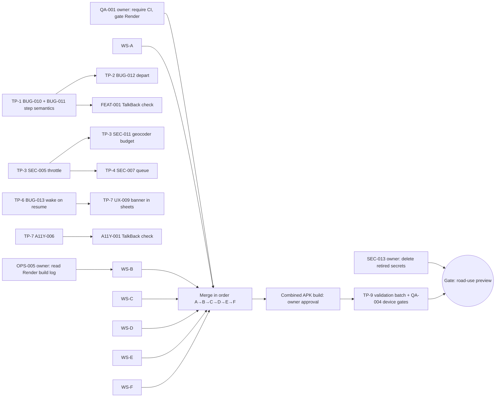

# NEXORA Maps: Implementation Plan (V2 re-audit)

Audit date 28 Nov 2026 · `main` @ `e2bd944` · Back to [MASTER_ROADMAP.md](MASTER_ROADMAP.md) · Short brief: [NEXT_SPRINT.md](NEXT_SPRINT.md)

Nothing here has been implemented. Each packet needs the owner's approval to start.

## 1. Dependency order



**Critical path:** TP-1 (BUG-010/011) → merge → combined APK → TP-9 (QA-004 LG rows and DHU). Nothing else blocks the road-use gate.

**Foundational unlocks:** SEC-005 (real client IPs) unlocks SEC-011 and FEAT-004. TP-1's single step meaning unlocks correct car output, StepList, announcements and FEAT-002.

## 2. Parallel workstreams (disjoint files) for one combined APK

These can run as separate threads because no two touch the same file. One developer doing them in sequence needs roughly 3 weeks; see [NEXT_SPRINT.md](NEXT_SPRINT.md) for the single-developer order and fallback.

| WS | Theme | Owns (only these files) | Items | Effort |
|---|---|---|---|---|
| **WS-A** | Guidance step semantics | `shared/nexora/session.ts`, `shared/nexora/car-guidance.ts`, `shared/nexora/maneuver.ts`, `shared/nexora/guidance.ts`, `server/nexora/route-mapper.ts`; tests `nexora-car-guidance`, `nexora-guidance`, `nexora-route-mapper`, new `nexora-session` | BUG-010, BUG-011, BUG-012, QA-006 (car-guidance part); stretch GEO-001 | 2-4 d |
| **WS-B** | API abuse, quota and errors | `server/nexora/routes.ts`, `server/nexora/geocoder.ts`, `server/_core/app.ts`, `render.yaml`; tests `server-routes`, `security-admin-account`, `nexora-itinerary` (GEO-004 case) | SEC-005, SEC-011, SEC-007, GEO-004, OPS-001, OPS-005 (fix if the log confirms), SEC-008, OPS-006, OPS-007, QA-003, QA-006 (server mock part) | 6-9 d |
| **WS-C** | Map document, traffic and server lifecycle | `server/nexora/map-document.ts`, `server/nexora/traffic.ts`, `shared/nexora/traffic.ts`, `server/_core/index.ts`, `server/_core/cors.ts`; tests `nexora-traffic`, `cors`, new `nexora-map-document` | SEC-006, UX-001, BUG-015, PERF-004, OPS-002 (server half), SEC-012 | 3-5 d |
| **WS-D** | Client networking | `lib/nexora-api-core.ts`, `lib/nexora-api.ts`, `hooks/use-nexora.ts`, `hooks/use-traffic.ts`; test `nexora-client-api` (+ new hook-level tests if feasible) | BUG-013, BUG-014, BUG-006 (stale-search test), QA-002 (controller tests for the reroute and search wiring) | 3-5 d |
| **WS-E** | Screens, safety prompts and accessibility | `components/nexora/NexoraApp.tsx`, `components/nexora/Panels.tsx`, `components/nexora/screen-logic.ts`, `components/nexora/live-ack.ts`, `components/nexora/StepList.tsx`, `lib/car/lock-screen-guidance.ts`; test `nexora-screens` | A11Y-006, UX-009, UX-010, UX-005, UX-003 (version key), QA-006 (screen source-text tests); stretch FEAT-005 + UX-004, UX-002 | 4-6 d |
| **WS-F** | Client Manus cleanup and docs | `app/_layout.tsx`, `app/oauth/**`, `lib/_core/**`, `lib/trpc.ts`, `hooks/use-auth.ts`, `constants/oauth.ts` (keep `getApiBaseUrl` exported where it is), `components/hello-wave.tsx`, `components/parallax-scroll-view.tsx`, `package.json`, `pnpm-lock.yaml`, `app.config.ts` (OAuth env lines only), `docs/FEATURE_MANIFEST.json`, `docs/DEVICE_TEST_PLAN.md`; test `release-config` | SEC-002 (client half), DEBT-001, DOC-003 | 2-3 d |

Rules for every workstream:
- Only WS-F changes `package.json` or the lockfile. Anyone needing a dependency asks first.
- Each workstream adds the tests for what it changes and runs `pnpm check`, `pnpm lint`, `pnpm test`, `pnpm build`.
- Merge order: **A → B → C → D → E → F.** WS-F goes last because of the lockfile; WS-E after WS-D because UX-009 renders the state BUG-013 fixes.
- No EAS build per workstream. One combined `production-apk` build after all merge, with the owner's typed approval.
- Shared-file hazards to watch: `components/nexora/NexoraApp.tsx` banner lines read `n.step`; WS-A changes what that value means, not the component. `hooks/use-nexora.ts` is WS-D only; WS-A must not edit it.

Owner tasks, not threads: QA-001 (two settings), SEC-013 (dashboards), OPS-005 (read the Render build log), DEBT-009 (decide on `wip/local-snap`), D1 below (merge PR #2).

## 3. Engineering task packets

### TP-1 · BUG-010 + BUG-011: one meaning for "step" in simulation, live and car output (WS-A)
- **Goal:** every surface shows the next manoeuvre and the distance to it.
- **Preconditions / evidence:** `shared/nexora/session.ts:42-50` (`playbackAt` returns the step being driven), `shared/nexora/guidance.ts:303-318` (`guidanceView` returns the upcoming step), `shared/nexora/car-guidance.ts:223-233` (`steps[index + 1]`), consumer `hooks/use-nexora.ts:336,922-938`, test `tests/nexora-car-guidance.test.ts:157-166`.
- **Steps:**
  1. Write the failing tests first: (a) for a 3-step fixture (depart 400 m, left at 400 m, right at 800 m), `playbackAt(route, 0.1).step` and `guidanceView(indexRoute(route), 100).step` both equal the left step with `distanceM ≈ 300`; (b) `buildCarGuidance` from either gives `next.instruction` = the left turn and `distanceToNextM ≈ 300`.
  2. Change `playbackAt` to return the upcoming step (first step whose start is ahead of the travelled distance) with `distanceM` = distance to its start, matching `guidanceView`. Keep the final-step and arrival behaviour.
  3. In `buildCarGuidance`, treat `input.step` as the next manoeuvre: drop the `+1` lookup; keep the arrived branch.
  4. Fix the mislabelled live test to build its step with `guidanceView`.
  5. Check other consumers of `playbackAt().step` (`grep -rn playbackAt`) and the voice prompt logic still agree; run the simulation in web (`pnpm dev`) and compare banner and voice.
- **Interfaces:** no type change; the meaning of `step` becomes uniform. Document it on `playbackAt` and `buildCarGuidance`.
- **Compatibility:** saved trips are unaffected (step data unchanged).
- **Tests:** equality test above; arrival at 100 %; zero-length step; single-step route.
- **Rollout / rollback:** ships in the combined APK; revert the PR to roll back.
- **Effort:** S (1-2 d). **Risk:** banner text in simulation changes visibly; update screenshots in `DEVICE_TEST_PLAN.md`.
- **Done when:** both new tests pass, the simulation banner and voice agree in a web smoke, CI green.

### TP-2 · BUG-012: compass heading for depart steps (WS-A)
- **Evidence:** `server/nexora/route-mapper.ts:45-46`, `shared/nexora/maneuver.ts:123`, tests `nexora-guidance.test.ts:148`, `nexora-route-mapper.test.ts:37`.
- **Steps:** add a `bearing_after` → compass word helper (8 points); depart instruction becomes "Head west on X" (or "Head west" with no name); ignore the depart modifier; `maneuverIcon` returns `navigation` for depart; `toCarManeuver` maps depart to the depart kind without a turn direction; update the two tests.
- **Tests:** table rows for bearings 0, 45, 90, 180, 270, 359; no instruction matches `/^Head (left|right|slight|sharp)/`.
- **Effort:** XS. **Done when:** table passes and the guidance screenshot shows "Head …" with the navigation icon.

### TP-3 · SEC-005 + SEC-011: real per-client limits and a geocoder budget (WS-B)
- **Evidence:** no `trust proxy` (`server/_core/app.ts:19`); `throttle(req.ip)` at `server/nexora/routes.ts:150,278`; one shared map at `:89-99`; no cache or budget at `:264-318`.
- **Steps:**
  1. `app.set("trust proxy", 1)` (Render adds one hop; confirm with a test that sets `X-Forwarded-For`).
  2. Separate buckets per route family (search, routes); evict idle entries; keep limits configurable by env.
  3. Add an LRU cache for normalised search queries (lowercase, trimmed, collapsed spaces; key includes limit). TTL within LocationIQ's caching terms (check them first; if caching is not allowed, skip the cache and keep the budget).
  4. Add a daily budget counter (UTC day) with env `NEXORA_GEOCODER_DAILY_BUDGET`; at the limit return 503 `{ error: "Search is busy today. Try again tomorrow." }` with no upstream call; report `searchBudgetRemaining` in capabilities.
- **Tests:** two clients with different `X-Forwarded-For` get separate buckets; the 16th request from one client gets 429 while another client still gets 200; repeat query → one upstream call; budget exhausted → 503 with zero upstream calls; key never in any response.
- **Observability:** count cache hits and budget use (numbers only).
- **Rollback:** env flags to disable cache and budget; revert PR.
- **Effort:** S-M (2-3 d). **Done when:** tests pass; capabilities shows the budget.

### TP-4 · SEC-007: bounded provider queues with deadlines (WS-B, after TP-3)
- **Evidence:** `server/nexora/routes.ts:52-88` (one chain, 15 s per call), `:170-205` (cycling makes up to 4 calls), client timeouts `lib/nexora-api-core.ts:44-48`.
- **Steps:** one queue per provider; depth cap (default 5) returning 503 fast; per-request `AbortController` aborted on `res.on("close")` before finish; check `signal.aborted` before and after waiting; total budget per request (9 s routes, 8 s search) below the client's reroute timeout; make spacing injectable for tests.
- **Tests:** client disconnect while queued → no upstream call; 7th queued request → 503 in under 100 ms; a slow upstream cannot hold a request beyond its budget.
- **Effort:** S (1-2 d). **Risk:** cycling re-snap may need its budget shared across its calls.

### TP-5 · SEC-006 + UX-001: harden and tidy the map document (WS-C)
- **Evidence:** `server/nexora/map-document.ts:17` (`postMessage(..., '*')`), `:23` (`bindTooltip(p.name)` as HTML), `:43` (no `e.origin` check), attribution at `:2,9,15`; screenshot `guidance-arrow.png` (3-line band mid-map).
- **Steps:** accept messages only from the WebView bridge (React Native) or the configured web origin; post to an explicit origin; pass place names as text nodes; move attribution to a compact collapsible control at bottom-left above the sheet (keep OSM and TfL credits reachable in one tap, as the licences require); add `Content-Security-Policy` with `frame-ancestors` on the map HTML if WS-B has not added it globally (coordinate: WS-B owns `app.ts`, WS-C owns the document string).
- **Tests:** new `tests/nexora-map-document.test.ts`: a message from another origin is ignored; a place name `` renders as text; attribution markup present and collapsed by default.
- **Effort:** S (1-2 d). **Done when:** tests pass and an emulator screenshot shows the map without a mid-map band.

### TP-6 · BUG-013: wake handling after downgrades and app resume (WS-D)
- **Evidence:** `lib/nexora-api-core.ts:243-253`, `hooks/use-nexora.ts:240`, `hooks/use-traffic.ts:46`.
- **Steps:** call `warmUp()` when `json()` downgrades to waking; add an AppState listener (in `lib/nexora-api.ts`) that marks the server waking and warms up after more than 14 minutes in the background; use `timeoutFor(state)` for reroutes, capped by the reroute budget; route the traffic fetch through `api.json`.
- **Tests:** downgrade → `/api/health` polled → final state ready or unreachable; resume after 20 min with a fake clock → next route uses the waking timeout; traffic success marks ready.
- **Effort:** S. **Done when:** tests pass; cold-start emulator run (TP-9) shows no failed first request after a long background.

### TP-7 · A11Y-006 + UX-009 + UX-010 + UX-005: safety and accessibility fixes on screen (WS-E)
- **Evidence:** `NexoraApp.tsx:207-213` and `screen-logic.ts:186-193` (announcement key); `NexoraApp.tsx:333-372,798-838` (banner under sheets); `lib/car/lock-screen-guidance.ts:115-117` (notification prompt); `NexoraApp.tsx:664-672`, `Panels.tsx:287-292` (unconfirmed end and delete); `live-ack.ts:6` (UX-003 key).
- **Steps:**
  1. A11Y-006: announce when the step identity (route id + step index) changes, not when the text changes; optional staged warnings reuse the voice thresholds.
  2. UX-009: a `panelServerNotice(serverState, busy)` helper; show its line at the top of search and routes panels; give the home banner a reserved slot below the map tools.
  3. UX-010: request notification permission in the live acknowledgement sheet (and from onboarding's location step); never from a guidance snapshot. Label the backgrounded live card "Guidance paused. Open NEXORA to continue."
  4. UX-005: the X button opens the same "End guidance?" sheet as the back key during live guidance; offline-region delete gets a destructive-style confirm.
  5. UX-003: key the acknowledgement to an identifier that changes every release. Option A (no new dependency): bump `version` in `app.config.ts` per release and document it in `docs/RELEASE.md`; that is a WS-F file, so hand the config line to WS-F. Option B: read the native build number through `expo-application` (not currently a dependency; adding it needs approval and goes through WS-F). Recommend A.
- **Tests:** announcement count equals step count over a ticking drive; `panelServerNotice` cases; back and X both route through the confirm; ack required again when the release identifier changes; replace the source-text assertions at `nexora-screens.test.ts:255-269` with behavioural ones.
- **Effort:** M (3-5 d). **Done when:** tests pass; emulator check of the four behaviours in TP-9.

### TP-8 · SEC-002 (client half): remove the OAuth route, tRPC and Manus runtime (WS-F)
- **Evidence:** `app/_layout.tsx:20,67,85,92`, `app/oauth/callback.tsx`, `lib/_core/api.ts:86-131`, `lib/trpc.ts:31`, `hooks/use-auth.ts`, `constants/oauth.ts`, `package.json` (`@trpc/*`, `superjson`, React Query if unused elsewhere: check with grep first).
- **Steps:** grep every import of these modules; move nothing out of `constants/oauth.ts` except deleting the OAuth helpers (keep `getApiBaseUrl` where it is so WS-D's files need no edit); delete the route, providers (check `@tanstack/react-query` has no other user before removing it), `initManusRuntime`, `lib/_core/{api,auth,manus-runtime}.ts`, `lib/trpc.ts`, `hooks/use-auth.ts`, unused template components; remove the dependencies; remove `MANUS_OAUTH_*`/`VITE_APP_ID` reads from `app.config.ts`. Do not change the bundle id or scheme (owner decision D2).
- **Tests:** a static test that no route under `app/` matches `oauth`; `release-config` asserts the removed dependencies; full suite and a web smoke of plan-route.
- **Effort:** S (1-2 d). **Risk:** a hidden import; typecheck will catch it.

### TP-9 · Validation batch and QA-004 device gates (after the combined APK)
- **Preconditions:** WS-A..F merged; combined `production-apk` build approved by the owner; build id and SHA recorded per `docs/RELEASE.md`.
- **Runs (emulator, then a physical phone for LG rows that need real GPS):**
  - BUG-001: let Render sleep 20+ min; cold-launch; time to waking overlay, map loaded, search showing LocationIQ.
  - BUG-008: back key in every state. BUG-009: clear app data; onboarding once. UX-003: second live start has no ack; bumped build re-asks.
  - A11Y-001, A11Y-006, FEAT-001: TalkBack with voice muted through a simulated trip; count announcements; use the step list only.
  - BUG-007: GPX detour replay (`docs/mock-gps/kings-cross-tate-modern-detour.gpx`) with network throttled.
  - PRIV-001: `aapt dump permissions <apk>`; expect no RECORD_AUDIO.
  - UX-009, UX-010, UX-005: banner visible in sheets while waking; no system dialog during guidance; X asks before ending.
  - QA-004: LG-1..LG-10 from `docs/DEVICE_TEST_PLAN.md` and the Android Auto DHU checklist from `docs/CAR_DISPLAYS.md`, including BUG-010's next-turn check on the car screen.
- **Record:** results table with build id, SHA, device, date, screenshots under `docs/screenshots/<build>/`, and manifest updates only where evidence supports them.
- **Effort:** M (2-4 d, mostly owner or emulator time).

## 4. First sprint execution details

See [NEXT_SPRINT.md](NEXT_SPRINT.md) for the single-developer order, investigations, definition of done and fallback scope.

## 5. Testing matrix

| Area | Unit (pure) | HTTP / integration | Hook / controller | Emulator | Physical device |
|---|---|---|---|---|---|
| Step semantics (BUG-010/011/012) | TP-1, TP-2 tables | — | — | Simulation banner + voice | LG rows, DHU |
| Throttle, budget, queue (SEC-005/011/007) | — | TP-3, TP-4 with strict fetch mocks | — | — | — |
| Map document (SEC-006, UX-001) | document string tests | `/api/nexora/map` headers | — | Screenshot of attribution | — |
| Cold start and resume (BUG-001/013, UX-009) | injected clock tests | — | AppState test | Sleep Render, cold launch, 20 min background | — |
| Announcements (A11Y-001/006) | ticking drive count | — | — | TalkBack | — |
| Back, confirm, ack (BUG-008, UX-003/005) | `screen-logic` | — | — | Each state | — |
| Traffic staleness (BUG-015, PERF-004) | fake system time | traffic endpoint | — | — | — |
| Client cleanup (SEC-002) | static route test | — | — | App starts, plans a route | — |

Negative and edge cases to include: zero-length steps, single-step routes, arrival at 100 %, client disconnect while queued, malformed JSON body, identical repeat search, budget at exactly the limit, AppState change during an in-flight request, voice on versus off.

## 6. Quality gates

- **Per PR:** `pnpm check`, `pnpm lint` (consider `--max-warnings 0` now that the warning is gone), `pnpm test`, `pnpm build` green in CI; new tests for every behaviour change; no new dependency outside WS-F.
- **Merge gate:** `verify` required on `main` (QA-001, owner setting).
- **Release gate (combined APK):** TP-9 rows recorded; BUG-010 checked on the DHU or a phone; no open P0.
- **Road-use preview gate:** QA-004 LG rows pass on a physical phone; UI keeps "unverified for road use" until then.
- **Performance protocol (no baselines exist yet):** on the emulator, with the same APK and route, record (1) cold launch to map visible against a sleeping and an awake API, (2) JS frame drops during 60 s of simulation (React DevTools profiler or `adb shell dumpsys gfxinfo`), (3) bridge payload size per tick (log `JSON.stringify(data).length` in a debug build). Use these as the baseline for PERF-001; targets stay proposals until measured.

## 7. Migration, rollout and rollback

- **Server (WS-B, WS-C):** Render auto-deploys `main`. Each PR is revertable; Render "Rollback to previous deploy" undoes a bad deploy. New limits and budget are env-configurable so they can be relaxed without a deploy.
- **Client (WS-A, D, E, F):** ships only in the combined APK. Keep the previous APK (build id in `docs/RELEASE.md`) installable for rollback. AsyncStorage keys are unchanged; the new ack key format must still treat the old `nexora-live-ack-v1` value as "seen for this version" or simply re-ask once (acceptable).
- **Old APKs against the new server:** search stays GET until PRIV-003, so old builds keep working; throttling becomes per client, which only helps them.

## 8. Reusable single-task prompt template

```text
NEXORA Maps — implement ONE approved backlog item: <ITEM-ID> (and only it)

Repo: C:\Users\andre\Documents\NEXORA-Maps (or the cloud clone of Amepps1994/nexora-maps).
Context: docs/roadmap/reaudit-2026-11-28-e2bd944/ (PRIORITISED_BACKLOG.csv row <ITEM-ID>,
TECHNICAL_AUDIT.md, IMPLEMENTATION_PLAN.md packet if one exists).

1. Check state first: git status --short --branch; git log -5 --oneline. Do not discard, stash
   or reset anything you did not create. If the tree has someone else's uncommitted work in files
   you need, stop and ask.
2. Re-verify the evidence: open every EvidencePaths entry for <ITEM-ID> and confirm the problem
   still exists at the current HEAD. If it is already fixed, report that and stop.
3. Scope: change only the files listed for this item's workstream (IMPLEMENTATION_PLAN.md §2).
   No new dependencies, no config or bundle-id changes, no unrelated refactors. Do not edit
   other items' files even if you notice problems; list them instead.
4. Branch: create <ws-or-item>/<short-name> from main.
5. Tests first: add a failing test that captures the AcceptanceCriteria, then implement.
   Include the negative and edge cases named in the row or packet.
6. Validate: pnpm check, pnpm lint, pnpm test, pnpm build. Never call live providers (LocationIQ,
   OSRM, TfL, Render) and never spend paid quota. No EAS build unless the owner approves it in
   writing for this task.
7. Open a PR describing: the item, what changed (files), tests added, commands run with results,
   what still needs emulator/device validation, and anything out of scope you noticed.
8. Do not update FEATURE_MANIFEST.json states without real runtime evidence.
```

## 9. Decisions needed from the owner

| ID | Decision | Recommendation |
|---|---|---|
| D1 | Merge PR #2 (previous roadmap) so both audits live on `main`? | Yes, docs only; this re-audit links to it |
| D2 | Final applicationId and URL scheme (still `space.manus…` / `manus…`) | Decide before wider distribution (DEBT-005); changing it means a fresh install for every tester |
| D3 | Accept the 8 s waking overlay (PR #6) instead of the original 3 s criterion? | Accept 8 s if the TP-9 cold-start run shows the spinner appears immediately |
| D4 | Daily LocationIQ budget value | 90 % of the plan's daily quota (check the plan page) |
| D5 | Delete `wip/local-snap`? | Yes if a diff against `bike-snap.ts` shows nothing missing (DEBT-009) |
