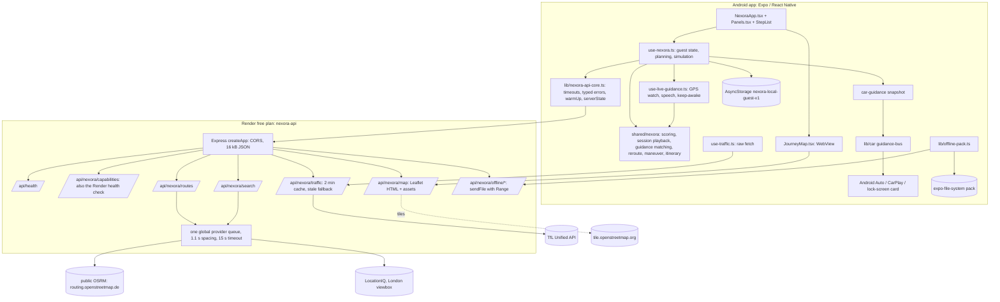

# NEXORA Maps: Technical Audit (V2 re-audit)

Audit date 28 Nov 2026 · `main` @ `e2bd944` · Baseline `7d4215a` · Back to [MASTER_ROADMAP.md](MASTER_ROADMAP.md)

## 1. Scope and methodology

- **Source of truth:** the PC working copy `C:\Users\andre\Documents\NEXORA-Maps`, branch `main` at `e2bd944`, even with `origin/main`. Tracked files were clean. The untracked folder `docs/screenshots/apk-e2bd944-2026-11-28/` (five emulator screenshots of the APK built from `e2bd944`) was viewed as runtime evidence.
- **Read-only.** The only writes are the nine files in this directory. No source, configuration or dependency was changed. Build output went to a scratch folder outside the repo. No dependency was installed (the existing `node_modules/` matched the lockfile).
- **Repository instructions:** there is no `CLAUDE.md`, `AGENTS.md` or `CONTRIBUTING.md`. Project rules come from `docs/HANDOVER.md` and `docs/ROADMAP.md`: no fabricated data, demo content labelled, manifest states change only with evidence.
- **Reviews:** three independent read-only reviews ran in parallel: (1) reconciliation of all 70 prior items, (2) server security and correctness, (3) client correctness, UX, accessibility and performance. The auditor consolidated them, merged duplicates and spot-checked the key claims against the code:
  - BUG-010: `car-guidance.ts:223-233` (`steps[index + 1]`) and `guidance.ts:303-318` (`guidanceView` returns the upcoming step), passed through `use-nexora.ts:922-938`. Confirmed.
  - UX-003: `live-ack.ts:6` keys on `expoConfig.version`; `app.config.ts:77` fixes it at `1.0.0`. Confirmed.
  - UX-005: guidance X button `onPress={n.end}` at `NexoraApp.tsx:664-672`. Confirmed.
  - SEC-005/006: `routes.ts`, `map-document.ts` and `server/_core/index.ts` have an empty diff against `7d4215a`; no `trust proxy` in `server/`. Confirmed.
- **Probes:** the client reviewer ran a throwaway script in a scratch folder with the repo's local `tsx` against the pure functions (`buildCarGuidance`, `guidanceView`, `playbackAt`, `stepAnnouncement`). That is the "VERIFIED-runtime (probe)" evidence for BUG-010 and A11Y-006. No app runtime was started.
- **Not done:** no live provider calls (LocationIQ, OSRM, TfL, Render), no emulator, device or Android Auto DHU run, no EAS build.
- **Evidence classes:** VERIFIED-static (execution path traced in code), VERIFIED-runtime (command, probe or screenshot), SUSPECTED, RISK, IMPROVEMENT, PROPOSED, as the V2 brief defines them.

## 2. Repository inventory (current)

| Path | What it is | Size / note |
|---|---|---|
| `app/` | Expo Router. `(tabs)/index.tsx` → `NexoraApp`; `oauth/callback.tsx` (Manus leftover, still routable); `dev/theme-lab.tsx` | `_layout.tsx` mounts tRPC + React Query + ErrorBoundary |
| `components/nexora/` | `NexoraApp.tsx` 1717 lines, `Panels.tsx` 1941, `JourneyMap.tsx` 322, `screen-logic.ts` 276, `StepList.tsx` 110, `ErrorBoundary.tsx` 70, `live-ack.ts`, `ui.tsx` | God files grew (DEBT-003) |
| `hooks/` | `use-nexora.ts` 1035 lines (42 `useState`), `use-live-guidance.ts` 318, `use-offline-regions.ts` 249, `use-traffic.ts` 126, `use-auth.ts` (unreferenced) | |
| `lib/` | `nexora-api-core.ts` 342 (new typed client), `nexora-api.ts`, `offline-pack.ts` 188, `car/*` (Android Auto, CarPlay, lock screen), `_core/*` and `trpc.ts` (Manus leftovers) | |
| `shared/nexora/` | Pure domain: `domain`, `session` (simulation playback), `guidance` (live matching), `reroute` (new), `maneuver` (new), `itinerary`, `traffic`, `offline`, `status`, `provider`, `car-guidance`, `fixtures` | Well tested |
| `server/_core/` | `app.ts` 34 lines, `index.ts`, `cors.ts` | Manus stack gone |
| `server/nexora/` | `routes.ts` 327 (capabilities, map, routes, search, admin deny), `geocoder.ts`, `traffic.ts`, `offline.ts`, `route-mapper.ts`, `bike-snap.ts`, `map-document.ts`, `map-assets/` (vendored Leaflet 1.9.4, pmtiles, protomaps-leaflet), `offline-data/london/` (56 MB PMTiles, 5.5 MB search index, tracked) | |
| `tests/` | 19 vitest files, 475 cases | |
| `docs/` | Product docs, `FEATURE_MANIFEST.json` (141 entries, unchanged since baseline), `RELEASE.md` (new), 30 dated logs | DOC-002, DOC-003 |
| Config | `app.config.ts` (bundle id still `space.manus…`), `eas.json` (base, preview, production-apk with autoIncrement), `render.yaml` (free plan, Frankfurt), `.nvmrc` 22, `.github/workflows/ci.yml` | |

**Stack:** Expo ~57, React Native 0.86, React 19.2, TypeScript (strict), expo-router, NativeWind, react-native-webview (Leaflet inside), expo-location, expo-speech, expo-keep-awake, expo-file-system, @iternio/react-native-auto-play, Express 4, zod 4, vitest. Package manager pnpm 9.12.0 (`node-linker=hoisted`).

**Repository health:** 29 commits on `main`, all dated 27 Nov 2026; 8 PRs, 7 merged; PR #2 (previous roadmap) open. No TODO/FIXME comments in app, server or shared code. `.git` is 89 MB, mostly the tracked offline pack. Docs drift: the feature manifest, device test plan and server capabilities strings were not updated with the sprint (DOC-003, OPS-001).

## 3. Current architecture

Coordinates are WGS84 `[lon, lat]` throughout the API and domain, converted to `[lat, lon]` only at the Leaflet boundary; zod tuples bound both. The service area is Greater London; no projection, antimeridian or polar handling is needed or claimed.

## 4. Feature status (code present versus verified)

| Area | Status | Runtime evidence at e2bd944 |
|---|---|---|
| Interactive map (online OSM raster, offline PMTiles) | IMPLEMENTED | Screenshots (online and offline) |
| Live search (LocationIQ, submit-only) | IMPLEMENTED | `search-tate-modern.png` |
| Routing (car, foot, bike), alternatives, scoring, multi-stop (3), leave-at/arrive-by | IMPLEMENTED | `route-tfl-disruptions.png` |
| Simulation with fault injection | IMPLEMENTED; banner semantics wrong (BUG-011); test buttons visible (UX-004) | Screenshots |
| Live GPS guidance, reroute, voice | PARTIAL: code + unit tests; no device validation (QA-004) | None |
| Car displays and lock-screen card | PARTIAL: wrong next turn in live mode (BUG-010); never run on DHU | None |
| TfL disruptions | PARTIAL: disruptions only; stale-data handling (BUG-015) | `route-tfl-disruptions.png` |
| Offline London map and search | IMPLEMENTED (no on-device sha256, GEO-002) | `offline-installed.png` |
| Offline routing | ABSENT | capabilities `offlineRouting:false` |
| Cold-start handling | IMPLEMENTED_UNVERIFIED | None timed |
| Back key, onboarding, live acknowledgement, step list, live regions, ErrorBoundary | IMPLEMENTED; partly verified | Back key in guidance only |
| Saved places, home/work, opt-in trips, export/delete | IMPLEMENTED (local) | Not re-checked |
| Accounts | ABSENT on server; client leftovers remain | n/a |
| CI | IMPLEMENTED, not a gate | Green run history |
| Crash reporting | ABSENT (console only) | n/a |

**Maturity:** private technical preview. Core planning flows work on the emulator. Live guidance and car displays are unvalidated, and this audit found one wrong-instruction defect on those surfaces.

## 5. Baseline validation ledger

| Check | Command | Ran | Outcome | Evidence |
|---|---|---|---|---|
| Git root and status | `git rev-parse --show-toplevel`, `git status --short --branch` | yes | PASS | Clean tracked tree; 1 untracked screenshot folder |
| Typecheck | `node node_modules/typescript/bin/tsc --noEmit` | yes | PASS | exit 0 |
| Unit tests | `node node_modules/vitest/vitest.mjs run` | yes | PASS | 19 files, 475 passed, 0 failed, about 8 s; providers mocked |
| Server build | `node node_modules/esbuild/bin/esbuild server/_core/index.ts --platform=node --packages=external --bundle --format=esm --outdir=<scratchpad>` | yes | PASS | 45.7 kB |
| Lint | `pnpm lint` | no | BLOCKED | pnpm not on PATH (OPS-008). A raw `eslint` run is not equivalent to `expo lint` and was not counted |
| Lint (CI) | GitHub Actions run 46054949938 | read | PASS | No ESLint problems in the log |
| CI history | `gh run list --limit 8` | yes | PASS | All green |
| Branch protection | `gh api repos/Amepps1994/nexora-maps/branches/main/protection` | yes | n/a | 404, not protected |
| Android export | `expo export --platform android` | no | SKIPPED | Not needed; a real APK was already built from this SHA |
| Device, emulator, DHU | — | no | SKIPPED | Needs the owner's emulator session |
| Live providers | — | no | SKIPPED | Not allowed (quota, live services) |

Local Node is v26.13.1 while the project pins 22. Tests passed locally and in CI (Node 22).

## 6. Bug, risk and improvement register (new items)

Items carried from the previous audit are reconciled in [ROADMAP_RECONCILIATION.md](ROADMAP_RECONCILIATION.md) and scored in the [CSV](PRIORITISED_BACKLOG.csv); their original write-ups are on the PR #2 branch. Below are the 23 new items, most important first.

### BUG-010 · Car display and lock-screen card show the manoeuvre after next during live GPS guidance
- **Class:** VERIFIED-static + VERIFIED-runtime (pure-function probe) · confidence high · **severity High · P0**
- **Change relationship:** NEWLY DISCOVERED; pre-existing since car-guidance landed. Hidden by `tests/nexora-car-guidance.test.ts:157-166`, which is labelled "live" but builds the step the simulation way.
- **Where:** `shared/nexora/car-guidance.ts:223-233` takes `steps[index + 1]`; `hooks/use-nexora.ts:336` passes `live.step`, and `shared/nexora/guidance.ts:303-318` (`guidanceView`) already returns the upcoming step.
- **Actual:** on a route "depart 400 m, left at 400 m, right at 800 m", 100 m in, the car and lock screen show "Turn right onto C Lane, 300 m". The real next turn is left.
- **Expected:** both modes show the same next manoeuvre and distance.
- **Root cause:** `playbackAt` (simulation) and `guidanceView` (live) mean different things by "step". Alternative: a `stepIsUpcoming` flag. Preferred: give both one meaning (see BUG-011) and drop the `+1` lookup.
- **Fix:** `shared/nexora/{session,car-guidance}.ts`. Effort S.
- **Acceptance:** for the same route and along-distance, live and simulation snapshots have identical `next.instruction` and `distanceToNextM`.
- **Regression test:** build the snapshot from `guidanceView(indexRoute(route), 100).step` and from `playbackAt(route, 0.1).step`; assert both equal the left turn. Then DHU check.
- **Rollback:** revert the PR; the app falls back to today's behaviour.

### BUG-011 · Simulation banner, step-list "current" and screen-reader text show the step being driven
- **Class:** VERIFIED-runtime (screenshots) + VERIFIED-static · high · **Medium · P1**
- **Relationship:** pre-existing banner behaviour; PR #7 built StepList and announcements on the same value.
- **Where:** `shared/nexora/session.ts:42-50` (`playbackAt`), `components/nexora/NexoraApp.tsx:457-470`, `StepList.tsx`, `screen-logic.ts:122-178`.
- **Actual:** banner shows "0.0 mi · Continue onto Farringdon Street" just before a turn while voice announces the turn. StepList marks the travelled step as current in simulation but the upcoming one in live mode.
- **Fix:** make `playbackAt` return the upcoming step with the distance to it, like `guidanceView`. Effort S.
- **Acceptance:** at 10 % of the probe route the simulation banner reads "Turn left onto B Street · 300 m".
- **Test:** `playbackAt(route, p).step` equals `guidanceView(indexRoute(route), p × total).step` (instruction, distance within 1 m).

### BUG-012 · Depart steps read "Head left/right onto X" and show a turn arrow
- **Class:** VERIFIED-runtime (`guidance-arrow.png`) + VERIFIED-static · high · **Medium · P1**
- **Relationship:** text pre-existing (`server/nexora/route-mapper.ts:45-46`); PR #4 made it worse: `shared/nexora/maneuver.ts:123` gives depart a turn icon and `car-guidance` a turn direction. Tests lock it in: `tests/nexora-guidance.test.ts:148`, `tests/nexora-route-mapper.test.ts:37`.
- **Expected:** OSRM's depart `modifier` is not a turn instruction. Use a compass word from `bearing_after` ("Head west on Euston Road") and the navigation icon.
- **Fix:** route-mapper depart branch, `maneuverIcon`, `toCarManeuver`. Effort XS.
- **Acceptance:** no instruction matches `/^Head (left|right|slight|sharp)/`; depart icon is the navigation arrow in the app and car.
- **Test:** depart rows in the route-mapper table for bearings 0/90/180/270; update guidance test 148.

### BUG-013 · Server state can stick on "waking"; no resume handling
- **Class:** VERIFIED-static · high · **Medium · P1**
- **Relationship:** introduced by PR #6 (`lib/nexora-api-core.ts:243-253`), interacts with the PR #7 banner.
- **Actual:** (a) after a timeout on a ready server, `json()` sets "waking" but nothing calls `warmUp()`, so the banner says "Waking…" until the user retries and never reaches "unreachable". (b) No AppState handling: after 15+ minutes in the background the first search or route uses the 12 s / 18 s timeout against a server that needs about 50 s and fails once. (c) Live reroutes use a fixed 10 s timeout (`hooks/use-nexora.ts:240`). (d) `hooks/use-traffic.ts:46` bypasses the client.
- **Fix:** call `warmUp()` on downgrade; on AppState "active" after more than 14 minutes, mark waking and warm up; route traffic through the client. Effort S.
- **Acceptance:** after a downgrade, the state resolves within 60 s with no user action; after 20 minutes in the background the first route request uses the waking timeout.
- **Test:** extend `tests/nexora-client-api.test.ts` "marks it waking again" to assert `/api/health` polling and a final state.

### A11Y-006 · TalkBack announces on every GPS fix or simulation tick
- **Class:** VERIFIED-static + VERIFIED-runtime (probe) · high · **Medium (High for screen-reader users with voice muted) · P1**
- **Relationship:** introduced by PR #7.
- **Where:** `components/nexora/NexoraApp.tsx:207-213`; `screen-logic.ts:186-193` suppresses only identical strings, but the text contains the live distance ("In 300 m…", "In 299 m…").
- **Fix:** key the announcement on step identity (route id + step index), optionally plus the staged `nextPrompt` thresholds. Effort XS.
- **Acceptance:** with voice muted, one announcement per new step and none on distance-only changes.
- **Test:** drive the logic across several steps with decreasing distances; announcements = steps.

### UX-009 · Server-wake banner hidden under the search and route sheets
- **Class:** VERIFIED-static (render order), consistent with screenshots · medium · **Medium · P1**
- **Relationship:** introduced by `8ba0164` (PR #7).
- **Where:** banner in `topArea` (`NexoraApp.tsx:333-372`); panels render later (`NexoraApp.tsx:798-838`) and reach about 112 dp from the top; `Panels.tsx` never reads `serverState`.
- **Fix:** a compact waking line inside the search and routes panels while `serverState !== "ready"`; move or reserve space for the home banner so it never overlaps map tools on short screens. Effort S.
- **Acceptance:** with the server asleep, the waking text is visible inside the sheet throughout a search; no overlap at 640 dp height.

### UX-010 · Notification permission prompt appears during guidance
- **Class:** VERIFIED-runtime (`guidance-arrow.png`) · high · **Medium · P1**
- **Where:** `lib/car/lock-screen-guidance.ts:115-117` asks on the first active snapshot.
- **Why it matters:** a system dialog over an active guidance screen is a distraction in a driving context. Also (RISK) live guidance is foreground-only, so a backgrounded lock-screen card can keep showing the last turn.
- **Fix:** ask in onboarding or the live acknowledgement, before Start; label the backgrounded live card "Guidance paused, open NEXORA". Effort S.
- **Acceptance:** no system dialog after guidance starts on a fresh install.

### SEC-011 · No LocationIQ quota protection
- **Class:** VERIFIED-static · high · **Medium · P1**
- **Where:** `server/nexora/routes.ts:264-318`, `server/nexora/geocoder.ts:69-86`. The only guard is the shared 15/min throttle (one bucket for everyone behind Render, SEC-005).
- **Fix:** in-memory LRU of normalised queries (TTL within LocationIQ's caching terms, to be checked) and a daily budget that returns 503 before the plan quota. Effort S. Depends on SEC-005.
- **Acceptance:** repeat query within TTL makes no upstream call; after the budget the endpoint returns 503 without calling upstream.

### OPS-005 · Render blueprint may not build as written (SUSPECTED)
- **Class:** SUSPECTED (static) · low · **Medium if it triggers · P1 (XS verification)**
- **Where:** `render.yaml:13` installs with `NODE_ENV=production` (`:17-18`); `esbuild` is only a devDependency. pnpm normally skips devDependencies in that case. Render deploys reportedly work, so the dashboard may differ from the blueprint. Also `NEXORA_TFL_APP_KEY` is not declared.
- **Verify:** read the latest Render build log. **Fix if confirmed:** `pnpm install --frozen-lockfile --prod=false`; declare the TfL key with `sync: false`.

### SEC-013 · Owner: delete retired secrets and the leaked database credential
- **Class:** VERIFIED-static (code no longer reads them) · medium · **High · P1 (owner, XS)**
- **Where:** `render.yaml:5-6`, `docs/HANDOVER.md:16`; client still reads `EXPO_PUBLIC_OWNER_OPEN_ID` (`constants/oauth.ts:17`).
- **Why:** the leaked `DATABASE_URL` is still a live credential if that database exists, whatever the app does now.
- **Acceptance:** Render and EAS show none of the retired names; the database user is removed or the database deleted.

### BUG-014 · Car and lock-screen guidance stay "active" after a caught crash (SUSPECTED)
- `hooks/use-nexora.ts:922-938` never publishes an idle snapshot on unmount; the new ErrorBoundary unmounts `NexoraApp`. Fix: publish idle in the effect cleanup. **Low · P2 · XS.**

### BUG-015 · Stale TfL snapshot served indefinitely
- `server/nexora/traffic.ts:141-152` returns the last snapshot after any failure for as long as the instance lives; `shared/nexora/traffic.ts:233-234,265` compute `planned` and expiry once. Ended closures keep drawing red. Fix: filter by `endsAt`, recompute `planned`, return 503 past 60 minutes. **Medium · P2 · XS.**

### QA-006 · Tests that hide defects
- `tests/server-routes.test.ts:46` answers any URL with the OSRM fixture; `tests/nexora-car-guidance.test.ts:157-166` mislabels simulation as live (hid BUG-010); `tests/nexora-screens.test.ts:255-269` assert source text. Fix: fail on unexpected hosts, use `guidanceView` in the live test, replace source-text checks. **Medium · P2 · S.**

### OPS-006 · Non-JSON error responses
- No error middleware (`server/_core/app.ts:18-34`): malformed JSON and 413 return Express HTML, with stack traces under `NODE_ENV=development`. Fix: final JSON error handler and JSON 404. **Low · P2 · XS.**

### OPS-007 · No provider-failure logging; mapping bugs mark the provider unavailable
- `server/nexora/routes.ts:213-219,254-257,291-296`. Fix: one structured line per failure (no query, key or coordinates); distinguish schema mismatch as degraded. **Low · P2 · S.**

### DOC-003 · Manifest and device plan not updated with the sprint
- `docs/FEATURE_MANIFEST.json` and `docs/DEVICE_TEST_PLAN.md` are byte-identical to `7d4215a`; capabilities strings stale (`routes.ts:129-133`). **Low · P2 · S.**

### Lower-priority new items (P3)
| ID | Finding | Evidence | Fix |
|---|---|---|---|
| UX-011 | Use my location clears routes without recalculating; provider refresh can spin 3-4 min while waking; Delete my data leaves two keys | `hooks/use-nexora.ts:674-677` | Recalculate; bound refresh; clear all `nexora-*` keys |
| SEC-012 | CORS still allows credentials, `Authorization`, PUT/PATCH/DELETE | `server/_core/cors.ts:105-113` | GET/POST/OPTIONS, `Content-Type`/`Accept`, no credentials |
| PRIV-003 | Search terms in the GET query string can reach request logs (RISK) | `server/nexora/routes.ts:264-265` | POST search; keep GET for old APKs |
| PERF-004 | No negative caching after a TfL failure (each request waits up to 12 s) | `server/nexora/traffic.ts:58,81-105` | 30-60 s backoff window |
| OPS-008 | PC runs Node 26 and has no pnpm on PATH, so `pnpm lint` cannot run locally | `.nvmrc`, `package.json` | Node 22 via nvm-windows or Volta; corepack pnpm |
| GEO-007 | Pack files cached 1 h while region list is no-store; rebuilt pack can mismatch | `server/nexora/offline.ts:39,71` | sha256-versioned immutable URLs or no-cache + ETag |
| DEBT-009 | `wip/local-snap` appears superseded by `bike-snap.ts` | `git show 9891fcc` | Owner deletes or ports |

## 7. Technical and security review summary

- **Access control:** the API is now anonymous by design. Admin paths are deny-by-default with a pinned route inventory test. No session, cookie or storage surface remains on the server.
- **Input validation:** zod tuples bound coordinates; avoidances are enum-whitelisted before reaching provider URLs; `q` is 3-150 characters; search output is re-validated. Offline file serving uses an id regex, a file allowlist and `sendFile` (Range and ETag tested). No path traversal or SSRF path found.
- **Abuse and cost:** the weakest area. One shared throttle bucket behind Render's proxy (SEC-005), an unbounded shared queue with server work outliving client timeouts (SEC-007), and no geocoder budget (SEC-011). Together they let one client degrade search and routing for everyone and drain the LocationIQ free quota.
- **Unsafe rendering:** the map document accepts `postMessage` from any origin and renders place names as HTML (SEC-006). Today places are demo fixtures, but any page can frame `/api/nexora/map`. No security headers (SEC-008).
- **Secrets:** the LocationIQ and TfL keys stay server-side and are never echoed (tested). The leaked database credential remains an owner action (SEC-013).
- **Privacy:** the server logs no coordinates, routes or queries. Trip history is opt-in; home and work are plaintext in AsyncStorage (PRIV-002). Search terms travel in a URL (PRIV-003).
- **Licensing:** the online basemap pulls tiles straight from `tile.openstreetmap.org`; the OSMF tile policy allows light use only (GEO-003, verify before wider beta). The attribution is present but drawn mid-map (UX-001). TfL attribution is shown. LocationIQ caching terms need checking before SEC-011's cache.
- **Dependencies:** no unused server packages remain; `@trpc/*` and `superjson` stay only for the client leftovers (SEC-002). No vulnerability claims are made; no audit tool was run.

## 8. Test gaps

| Gap | Risk it hides | Item |
|---|---|---|
| No hook or component tests (`use-nexora`, `use-live-guidance`, `JourneyMap`, `NexoraApp` back-handler wiring, `lock-screen-guidance`) | Wiring defects like BUG-010, BUG-014 | QA-002 |
| No live-guidance GPX replay through the controller | Off-route, reroute and arrival in sequence | QA-002 |
| No stale-search test | Older results overwriting newer | BUG-006 |
| No 429, queue-saturation, malformed-search or key-echo tests | SEC-005, SEC-007, SEC-011 regressions | QA-003 |
| Mocks that accept any URL; mislabelled live test; source-text assertions | False passes | QA-006 |
| No map-document origin test; no header tests | SEC-006, SEC-008 | SEC-006 |
| No device rows recorded since the baseline | Road-use safety | QA-004 |

Suggested pyramid: keep the pure domain tests (most of the 475); add a thin layer of hook tests with `@testing-library/react-native` (a new dev dependency, needs approval) or controller extraction; add HTTP tests per route with strict mocks; keep one emulator smoke script per release and the LG device rows as the top layer.

## 9. Blockers and limitations

- No device, emulator, DHU or Render access in this audit; every runtime claim comes from the five screenshots or pure-function probes.
- `pnpm` is unavailable on the PC, so `pnpm lint` was taken from CI.
- Render dashboard settings, real cold-start timing and the LocationIQ plan quota are unknown.
- Performance was not measured. No numbers are claimed; see the benchmark protocol in [IMPLEMENTATION_PLAN.md](IMPLEMENTATION_PLAN.md#6-quality-gates).
